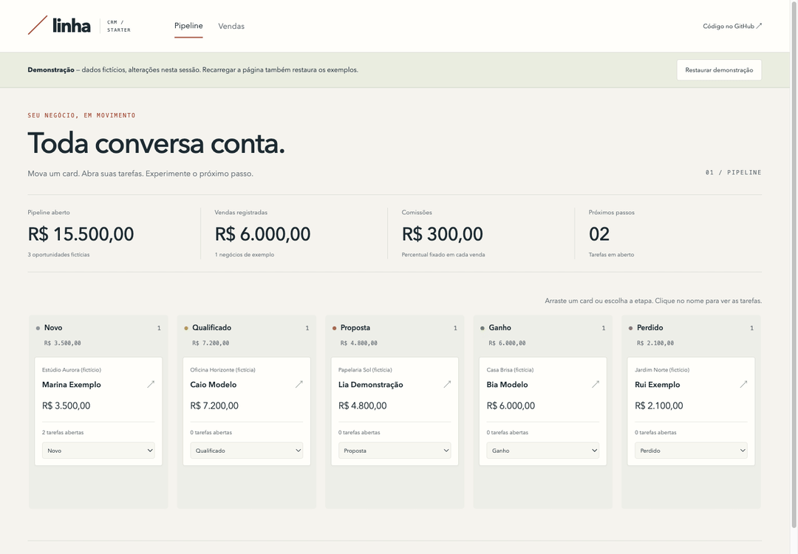

# Linha — CRM Kanban Starter

[](https://github.com/VictorPimentaDev/crm-kanban-starter/actions/workflows/ci.yml)
[](LICENSE)


**English summary:** A small Next.js and Supabase CRM with a lead kanban,
per-lead tasks, sales and commission snapshots. Local-first setup, email/password
authentication and database-enforced isolation between users. Try the interactive
`/demo` without an account, credentials or a backend; all changes stay in memory.



[Captura estática da demonstração](public/assets/demo.png) · **[Abrir demo pública](https://crm-kanban-starter.vercel.app/demo)**.

Um ponto de partida para organizar contatos e acompanhar vendas. Cada conta tem
seu pipeline, suas tarefas e seu histórico. O código foi escrito do zero para
este starter, inspirado no conceito de um CRM de vendas; não inclui código,
dados de clientes ou integrações privadas de outro produto.

O GIF usa capturas reais da interface: mover lead, concluir/criar tarefa e registrar
R$100,05 a 10%, com comissão de R$10,01. A demo pública não depende do Supabase.

## Experimentar sem backend

```bash
npm ci
npm run dev
```

Abra [localhost:3000/demo](http://localhost:3000/demo). A demonstração permite mover
leads, adicionar e concluir tarefas, registrar uma venda e conferir a comissão.
Tudo é fictício e fica apenas na memória da página. **Restaurar demonstração**
ou recarregar a página volta aos exemplos iniciais; nenhuma alteração é enviada
a um servidor, salva em localStorage ou misturada à conta do Supabase.

O board, o formulário de vendas e o cálculo de comissão são os mesmos do CRM.
A demo só troca a persistência por estado em memória. Sem variáveis do Supabase,
a página inicial oferece um acesso direto à demonstração e as instruções locais.

## Rodar com seu banco local

Você precisa de Node.js 24, npm, Supabase CLI e um Docker compatível em execução.
Os comandos abaixo rodam na pasta do repositório:

```bash
npm ci
supabase start
cp .env.example .env.local
supabase status
```

Preencha `NEXT_PUBLIC_SUPABASE_URL` e `NEXT_PUBLIC_SUPABASE_ANON_KEY` em
`.env.local` com a URL da API e a chave **anon** do ambiente local. Essa chave é
pública por desenho; a proteção dos dados depende da sessão e das políticas RLS.
Nunca use a chave `service_role` no frontend. O arquivo local está no `.gitignore`.

```bash
npm run dev
```

Abra [localhost:3000](http://localhost:3000), clique em **Ainda não tenho conta**
e crie uma conta. A confirmação de e-mail está desabilitada somente na configuração
local deste starter. Não há usuário ou senha compartilhados no seed.

Na conta vazia, **Carregar demonstração** cria cinco leads fictícios, duas tarefas
e uma venda com comissão. Os endereços usam `example.com`. O seed é uma função SQL
autenticada e transacional: cada pessoa cria seus próprios registros. Uma segunda
execução numa conta com leads é recusada, preservando o que já existe.

Para encerrar o backend local, execute `supabase stop`. `supabase db reset` é uma
operação destrutiva: recria o banco local a partir das migrations e apaga seus dados
de desenvolvimento. Não é necessário resetar para usar a demonstração.

## Usar

O pipeline tem cinco etapas: **Novo → Qualificado → Proposta → Ganho / Perdido**.
Arraste um card entre colunas ou use o seletor no próprio card, que também funciona
por teclado e em telas de toque. A busca filtra nome, empresa e e-mail.

Em **Novo lead**, informe o nome e, se fizer sentido, empresa, e-mail e valor
estimado. Clique no nome de um card para abrir suas tarefas. Cada tarefa aceita
prazo opcional e pode ser marcada como concluída.

Em **Vendas**, escolha um lead, informe o valor e o percentual de comissão.
A prévia mostra o valor antes de confirmar. O banco registra venda e comissão
na mesma transação e move o lead para Ganho. Mover um card para Ganho, por si só,
não registra receita nem comissão.

## Regras de dinheiro

Valores são inteiros em centavos. Percentuais são inteiros em pontos-base:
`500` significa 5,00%. O formulário aceita ponto ou vírgula como separador
decimal, até duas casas, sem separador de milhar.

```text
comissão em centavos = floor((venda em centavos × pontos-base + 5000) / 10000)
```

O arredondamento é para o centavo mais próximo, com empate para cima. Por exemplo,
R$100,05 a 10% resulta em R$10,01. A regra roda na prévia TypeScript e num trigger
SQL; a comissão exibida no histórico é a que o banco gravou.

O starter permite uma venda por lead, de R$0,01 até R$10 milhões, com percentual
de 0% a 100%. Venda e comissão são registros definitivos nesta versão. Alterar
o percentual de uma nova venda não recalcula as anteriores. Cancelamentos,
estornos, parcelamento, pagamento de comissões e edição do histórico ficam fora
deste MVP; implemente um fluxo auditável antes de acrescentá-los.

## Dados e acesso

| Tabela | Responsabilidade |
| --- | --- |
| `leads` | Contato, etapa e valor estimado |
| `tasks` | Tarefa vinculada a um lead do mesmo usuário |
| `deals` | Venda e percentual de comissão fixado no registro |
| `commissions` | Valor calculado pelo banco para cada venda |

Todas as tabelas têm RLS por `auth.uid()`. Chaves estrangeiras compostas impedem
vincular tarefas e vendas a leads de outra conta. Usuários autenticados não podem
escrever diretamente em comissões nem alterar uma venda registrada. A função
que grava a comissão tem `search_path` fixo e só é chamada pelo trigger.

O cliente usa a sessão do Supabase e carrega os registros em páginas de mil para
evitar truncamento pelo limite da API. A interface mantém o conjunto em memória;
para bases maiores, acrescente paginação e agregações no servidor. Não há equipes,
papéis administrativos ou atualização em tempo real entre abas neste starter.

## Verificar

```bash
npm run lint
npm run typecheck
npm test
npm run build
```

Os testes Vitest cobrem o parser decimal, os limites e o arredondamento de
comissões, renderização e movimentação do board, além do fluxo da demo: tarefas,
venda com arredondamento, validação e restauração de dados. O GitHub Actions executa
lint, typecheck, testes e build com dependências do lockfile.

O teste SQL executa as políticas e constraints contra um banco local real.
Com o Supabase iniciado, informe a senha local do banco quando solicitada:

```bash
psql -h 127.0.0.1 -p 54322 -U postgres -d postgres -W \
  -v ON_ERROR_STOP=1 -f supabase/tests/ownership.sql
```

Ele usa dois usuários de teste numa transação e termina com rollback. Verifica
isolamento, vínculos entre donos diferentes, acesso anônimo, arredondamento,
imutabilidade, rollback de venda inválida e seed por usuário. Não exige credenciais
de um projeto hospedado. O CI padrão não inicia a stack Supabase.

## Estrutura

- `src/app`: páginas do pipeline, das vendas e da demonstração `/demo`.
- `src/components`: autenticação, workspace e board.
- `src/lib/domain.ts`: regras monetárias e tipos do domínio.
- `src/lib/demo.ts`: exemplos fictícios e simulação de venda em memória.
- `supabase/migrations`: schema, políticas, trigger e função de demonstração.
- `supabase/tests`: verificações de banco com rollback.

A demo pode ser publicada na Vercel sem variáveis do Supabase. Para publicar o CRM
com dados persistentes, revise configuração de Auth, confirmação de e-mail,
URLs de redirecionamento e operação do banco.

A arte original para compartilhamento está em
[`public/assets/social-preview.png`](public/assets/social-preview.png)
(1280 × 640, menos de 1 MB), com fonte SVG ao lado. Ela também aparece nos metadados
Open Graph da aplicação. Na Vercel, a origem usa `VERCEL_PROJECT_PRODUCTION_URL`.
A imagem está pronta para configurar a social preview do GitHub quando o
repositório for tornado público após a revisão.

Licença [MIT](LICENSE).
